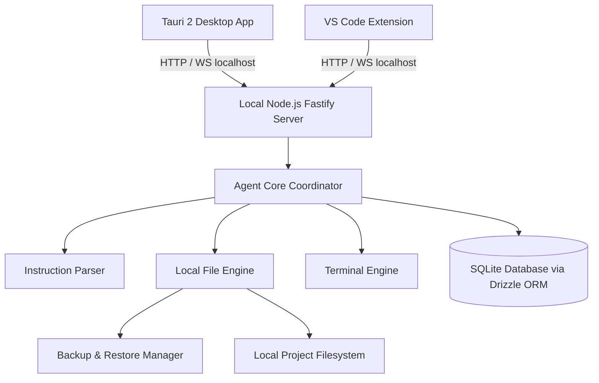

# CodePilot Local — Architecture

## 1. System Overview

CodePilot Local is a deterministic, local-first coding automation engine that converts human- or AI-provided instructions (from ChatGPT, Claude, DeepSeek, etc.) into safe, structured file operations on the user's computer.

## 2. Key Architectural Decisions

1. **Deterministic Execution:** No AI model or paid API is used locally or remotely. All parsing, path detection, and file generation work strictly from the user's provided input.
2. **Local-First Boundary:** All communication is strictly bounded to `127.0.0.1`. Host and Origin headers are strictly checked to prevent unauthorized browser-based requests.
3. **Single Source of Truth:** Both the Desktop Application and the VS Code Extension communicate with the same Local Fastify Server and SQLite database.
4. **Approval & Non-Destructive Protection:**
   - Existing files cannot be modified or deleted without explicit user review.
   - An automatic backup snapshot is created before any file is touched.
   - Diffs are computed and presented before execution.
5. **Atomic Operations:** Temporary writes with atomic rename prevent file corruption if an operation is aborted or interrupted.
